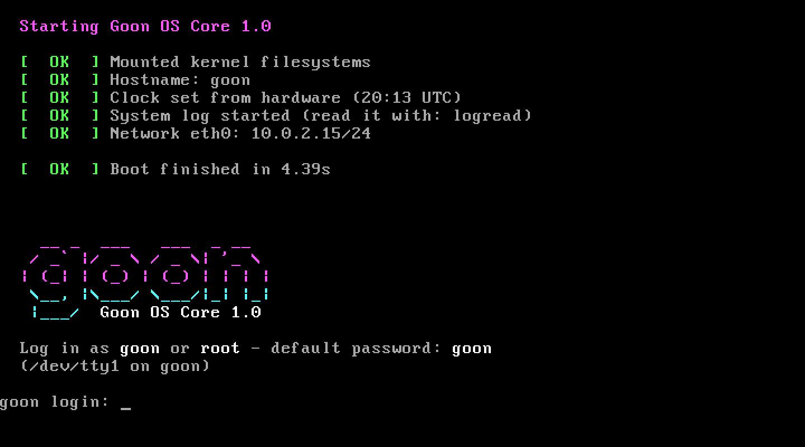
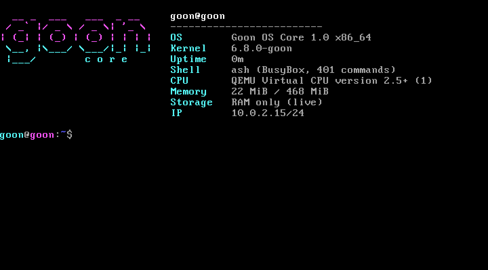

<div align="center">

<pre>
  __ _  ___   ___  _ __
 / _` |/ _ \ / _ \| '_ \
| (_| | (_) | (_) | | | |
 \__, |\___/ \___/|_| |_|
 |___/        o s
</pre>

# Goon OS

**An open-source Linux operating system that comes in three editions: from a terminal OS that fits in RAM up to a full desktop.**

[](https://github.com/Iamshi-vissa/goon-OS/actions/workflows/core.yml)


</div>

---

## Editions

| Edition | For | Built with | Size | Status |
|---|---|---|---|---|
| **[Core](core/)** | Terminal users, learning how an OS works, old or tiny machines, rescue sticks | Linux kernel + BusyBox, compiled from source | 25 MB ISO | ✅ **1.0, boots and passes all tests** |
| **[Lite](lite/)** | A light graphical desktop for older PCs (2 GB RAM) | Debian 13 + LXQt | ~1.2 GB ISO | 📝 planned |
| **[Desktop](desktop/)** | Everyday desktop use, with apps and an installer | Debian 13 + Xfce, live-build | ~3 GB ISO | 🧪 1.0 config written, first build pending |

All three share the same name, look and `goon` commands, so moving between editions feels familiar.

---

## Goon OS Core

The terminal edition. It boots to a login prompt in seconds and runs entirely in RAM, so nothing touches your disk unless you ask it to.

| Boot | After login: `goonfetch` |
|---|---|
|  |  |

**Features**

- 🐧 **Built from source:** Linux kernel + BusyBox (about 400 Unix commands in one static binary), with Goon's own startup scripts and tools on top.
- 💾 **Live by default:** everything runs in RAM. Run `goon persist setup` on a spare partition to keep `/home` and `/root` across reboots.
- 🌐 **Networking out of the box:** wired Ethernet gets an address automatically over DHCP (Intel, Realtek and virtio network cards).
- 🖥️ **Boots anywhere:** one hybrid ISO for BIOS and UEFI PCs, from a USB stick, CD or virtual machine.
- 🛠️ **The `goon` tool:** network status, disk listing, persistence and a one-command file server.
- 👥 **Multi-user:** separate `root` and `goon` accounts, password login, three virtual consoles (Alt+F1 to F3) and a serial console.

### Try it

1. Download the ISO from [Releases](https://github.com/Iamshi-vissa/goon-OS/releases), or build it yourself (below).
2. **In a virtual machine:** open the ISO in VirtualBox, VMware or QEMU (`./core/scripts/run-qemu.sh`).
3. **On a real PC:** write the ISO to a USB stick with [balenaEtcher](https://etcher.balena.io), [Ventoy](https://www.ventoy.net) or `dd`. Turn **Secure Boot off**, then boot from the stick.
4. Log in as **`goon`** or **`root`**. The default password is **`goon`**, so change it with `passwd`.

### The `goon` command

```text
goon info                 system overview (same as goonfetch)
goon net                  network address, gateway and DNS
goon net up               ask for a new DHCP address (root)
goon disks                list disks and partitions
goon persist              do my files survive a reboot?
goon persist setup DEV    keep files on a partition (ERASES it)
goon serve [DIR] [PORT]   share a folder over HTTP
goon editions             the three editions of Goon OS
goon version              version numbers
```

### Build it

On any Linux machine (or WSL2). Root is not needed.

```bash
# Debian / Ubuntu
sudo apt install build-essential flex bison bc libelf-dev libssl-dev cpio xz-utils \
                 bzip2 curl grub-pc-bin grub-efi-amd64-bin grub-common xorriso mtools

git clone https://github.com/Iamshi-vissa/goon-OS.git
cd goon-OS/core
./build.sh                    # → out/goon-os-core-1.0-x86_64.iso
./scripts/run-qemu.sh         # try it in a VM
```

The first build downloads Linux and BusyBox, verifies their checksums, and compiles both. That takes 10–40 minutes depending on your CPU. Rebuilding after you edit OS files takes seconds (`./build.sh rootfs iso`).

### How it boots

```
BIOS / UEFI firmware
 └─ GRUB boot menu                    core/config/grub.cfg
     └─ Linux kernel (-goon)          core/config/kernel.fragment
         └─ initramfs: the whole OS, unpacked into RAM
             └─ BusyBox init          core/rootfs/etc/inittab
                 ├─ rcS: mount /proc /sys /dev, clock, logging, storage, network
                 └─ getty → login → ash shell with the goon tools
```

There are more details, test instructions and a roadmap in **[core/README.md](core/README.md)**.

---

## Goon OS Desktop

A complete desktop based on Debian 13 "Trixie":
- **Desktop and look:** Xfce with a dark Arc theme, Papirus icons and the Inter font.
- **Apps:** Firefox, LibreOffice and VLC, plus an app store with Flathub.
- **Installer:** Calamares installs it to disk.
- **Hardware:** firmware is included, so Wi-Fi and graphics work on most PCs.

```bash
cd desktop
./build.sh            # on Debian 13
./build-docker.sh     # or anywhere with Docker
```

See **[desktop/README.md](desktop/README.md)** for the full guide and first-build checklist.

## Goon OS Lite

A lightweight graphical edition for older hardware, aiming for under 400 MB RAM in use after login. It's in planning. See **[lite/README.md](lite/README.md)**. Help is welcome!

---

## Repository layout

```
goon-OS/
├── core/                 terminal edition (kernel + BusyBox, from source)
│   ├── build.sh          build pipeline: fetch → kernel → busybox → rootfs → iso
│   ├── config/           kernel, BusyBox and GRUB configuration
│   ├── rootfs/           Goon's own files inside the OS (init, goon tool, ...)
│   └── scripts/          run in QEMU, automated boot + persistence tests
├── lite/                 lightweight desktop edition (planned)
├── desktop/              full desktop edition (Debian live-build)
├── .github/workflows/    CI: builds Core and boot-tests it on every push
├── CONTRIBUTING.md
└── LICENSE
```

## Roadmap

- [x] **Core 1.0:** bootable terminal OS, BIOS + UEFI, persistence, automated boot tests
- [ ] **Core:** Wi-Fi support (`goon wifi`)
- [ ] **Core:** `gpkg`, a tiny package manager
- [ ] **Core:** keyboard layouts and an install-to-disk option
- [ ] **Desktop 1.0:** first verified build and install
- [ ] **Lite 1.0:** LXQt edition for older PCs
- [ ] ISO downloads on GitHub Releases for every version

## Contributing

Bug reports, ideas and pull requests are welcome. Read **[CONTRIBUTING.md](CONTRIBUTING.md)** first. In short: build it, boot it, and run `shellcheck` on your scripts before opening a PR.

## License

Goon OS's own code is released under the **[MIT License](LICENSE)**. The ISOs also contain third-party software under its own licenses. Most notably, the Linux kernel and BusyBox are GPL-2.0.
