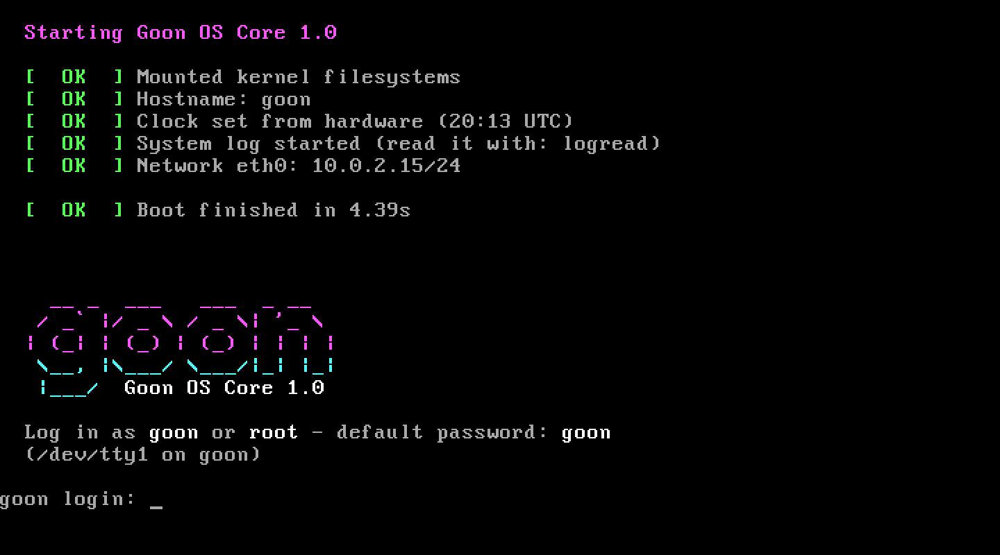
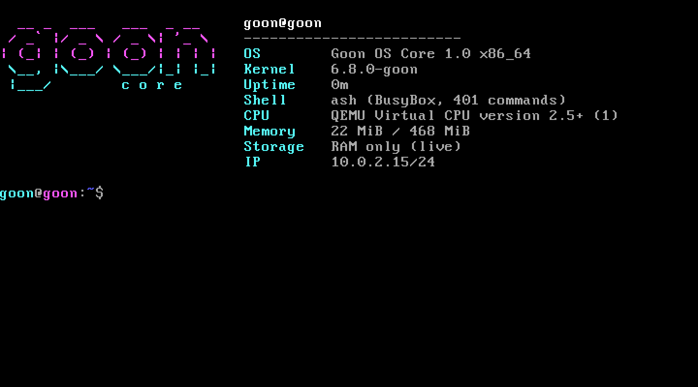

# Goon OS Core

The terminal edition of Goon OS. Built from source as just **the Linux kernel, BusyBox, and Goon's own init scripts and tools**, with no package manager or GUI.

- **Small:** a 1.1 MB compressed root filesystem plus one kernel; 25 MB ISO including the BIOS + UEFI boot loader.
- **Fast:** boots to a login prompt in a few seconds on real hardware.
- **Live:** runs entirely in RAM, so nothing touches your disk unless you ask it to.
- **Boots anywhere:** one hybrid ISO for BIOS and UEFI PCs, from CD, USB stick or VM.

| Boot | After login, `goonfetch` |
|---|---|
|  |  |

## Build it

Build on a Linux machine (or WSL2). No root needed.

```bash
# Debian / Ubuntu
sudo apt install build-essential flex bison bc libelf-dev libssl-dev cpio xz-utils \
                 bzip2 curl grub-pc-bin grub-efi-amd64-bin grub-common xorriso mtools
# Arch
sudo pacman -S base-devel bc libelf openssl cpio xz curl grub xorriso mtools

./build.sh
```

The first build downloads Linux and BusyBox, checks their SHA-256 sums, and compiles both: 10–40 minutes depending on your CPU. The ISO lands in `out/`.

| Command | What it does |
|---|---|
| `./build.sh` | everything: fetch → kernel → busybox → rootfs → iso |
| `./build.sh rootfs iso` | just repack after editing files in `rootfs/` (seconds) |
| `./build.sh kernel` | rebuild only the kernel |
| `./build.sh clean` | delete build output, keep downloads |
| `KERNEL_VERSION=6.18.x ./build.sh` | build against another kernel release |

## Run it

```bash
sudo apt install qemu-system-x86 ovmf
./scripts/run-qemu.sh            # opens a VM window
./scripts/run-qemu.sh --uefi     # UEFI firmware instead of BIOS
./scripts/run-qemu.sh --serial   # no window, use this terminal
./scripts/run-qemu.sh --disk     # with a 1 GB test disk for persistence
```

**On a real PC:** write the ISO to a USB stick with `sudo dd if=out/goon-os-core-1.0-x86_64.iso of=/dev/sdX bs=4M status=progress`, or with balenaEtcher or Ventoy. Then boot from the USB stick, with **Secure Boot turned off**.

Log in as **`goon`** or **`root`**. The default password for both is `goon`, so change it with `passwd`.

## Using Goon OS Core

| Command | |
|---|---|
| `goon help` | list everything below |
| `goon info` / `goonfetch` | system overview with the logo |
| `goon net` · `goon net up` | network status · ask for a new DHCP address |
| `goon disks` | disks, partitions, filesystems, labels |
| `goon persist` | whether your files survive a reboot |
| `goon persist setup /dev/sdXN` | format a partition as Goon storage (**erases it**) |
| `goon serve [dir] [port]` | share a folder over HTTP |
| `goon editions` · `goon version` | about this OS |

About 400 BusyBox commands are built in: `vi`, `top`, `ps`, `free`, `df`, `wget`, `ping`, `ip`, `nc`, `tar`, `gzip`, `grep`, `sed`, `awk`, `find`, `httpd`, `fdisk`, `mkfs.ext2` and more (`busybox --list`). You get three login screens on **Alt+F1 / F2 / F3**. Use `logread` for the system log and `dmesg` for the kernel log. To shut down, run `poweroff` or `reboot` as root.

### Keeping your files

By default everything lives in RAM and is gone at power-off. To keep `/home` and `/root`, give Goon a partition. It can be a spare partition on a USB stick or a disk:

```bash
goon disks                         # find the partition, e.g. /dev/sdb2
su -c 'goon persist setup /dev/sdb2'
```

At every boot after that, Goon finds the partition by its **GOON_DATA** label and mounts it automatically.

## How it works

```
firmware (BIOS/UEFI)
 └─ GRUB             config/grub.cfg            boot menu, also on the serial port
     └─ Linux        config/kernel.fragment     all drivers built in, no modules
         └─ initramfs (the whole OS, unpacked into RAM)
             └─ /init → BusyBox init           rootfs/etc/inittab
                 ├─ rcS                         rootfs/etc/init.d/rcS
                 │   mount /proc /sys /dev, clock, syslog, persistence, DHCP
                 └─ getty ×3 + serial → login → ash (rootfs/etc/profile)
```

| Path | Purpose |
|---|---|
| `build.sh` | the build pipeline, one function per stage |
| `config/kernel.fragment` | kernel options layered on `x86_64_defconfig` + `kvm_guest.config` |
| `config/busybox.fragment` | BusyBox options layered on its `defconfig` (static binary) |
| `config/grub.cfg` | boot menu |
| `rootfs/` | Goon's own files, copied over the BusyBox install |
| `rootfs/usr/bin/goon`, `goonfetch` | the Goon tools (POSIX shell) |
| `scripts/mkinitramfs.sh` | packs the root filesystem with root ownership, without needing root |
| `scripts/smoke-test.exp` | boots the ISO headless and checks login, network, users, poweroff |

Kconfig quietly drops options whose dependencies aren't met. `build.sh` therefore checks that the important kernel options actually ended up in `.config`, and stops the build if one is missing.

## Test

```bash
sudo apt install expect qemu-system-x86 ovmf fdisk
./scripts/smoke-test.exp out/goon-os-core-1.0-x86_64.iso bios   # boot, login, network, users, poweroff
./scripts/smoke-test.exp out/goon-os-core-1.0-x86_64.iso uefi
./scripts/persist-test.exp out/goon-os-core-1.0-x86_64.iso       # files survive a reboot
```

These have passed on BIOS and UEFI with **Linux 6.8 + BusyBox 1.36.1**. The default versions (6.12.117 / 1.37.0) use the same configs, but haven't been boot-tested yet: the first CI run covers them.

CI runs all three on every push that touches `core/` (see `.github/workflows/core.yml`).

## Known limits

- **No Wi-Fi yet.** Wired Ethernet works (Intel, Realtek, virtio). Wi-Fi needs firmware blobs and `wpa_supplicant`, so it's on the roadmap.
- **No Secure Boot.** The kernel and GRUB are unsigned, so turn Secure Boot off in the firmware settings.
- **US keyboard layout** only for now.
- **No package manager.** To add a program, put a static binary in `rootfs/usr/local/bin/` and rebuild.

## Roadmap

- [ ] `gpkg`: a tiny package manager for static binaries
- [ ] Wi-Fi (firmware + `wpa_supplicant` + `goon wifi`)
- [ ] Keyboard layouts (`goon keymap`)
- [ ] Install to disk (`goon install`) as an alternative to persistence
- [ ] arm64 build (Raspberry Pi)

## Licenses

Goon's own scripts are MIT-licensed (see `../LICENSE`). The kernel and BusyBox are GPL-2.0. If you **distribute** ISOs, publish the exact `downloads/` tarballs and `config/` alongside them to meet the GPL.
